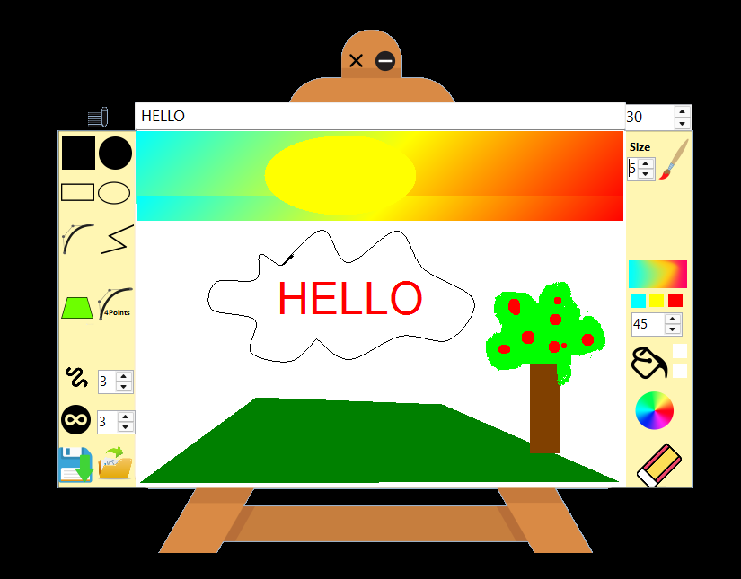

<div align="center">
  
</div>

<br>

**A small desktop drawing studio, built from scratch in C#.**

This was my way of learning what happens behind the tools we use every day: how a mouse movement becomes a brushstroke, how a handful of points becomes a curve, and how a Windows Forms interface can feel like a real creative workspace.

`C#` &nbsp; · &nbsp; `Windows Forms` &nbsp; · &nbsp; `System.Drawing / GDI+` &nbsp; · &nbsp; `.NET 5 (original)`

---

### On the canvas

<div align="center">
  
  <br>
  <sub>Actual screenshot of the running application .</sub>
</div>

<br>

### What you can make

| Draw | Experiment | Keep |
| :--- | :--- | :--- |
| Freehand strokes and erasing | Custom colours and brush sizes | Place text on the canvas |
| Lines, rectangles and ellipses | Filled shapes and gradients | Import an image |
| Bézier and freeform curves | Filled polygons | Export as PNG, JPEG or BMP* |

### Under the hood

The interface is built with **Windows Forms**, while **GDI+** handles the drawing itself. Mouse and control events drive the tools, with different drawing modes for strokes, shapes, text, curves and image operations.

Rather than a web-based drawing demo, this is a native **Windows desktop project** — a hands-on exercise in event-driven programming, UI design and 2D graphics.

### Open the project

1. Download this repository (**Code → Download ZIP**) or clone it.
2. On Windows, open `Paint_/Paint_.csproj` in Visual Studio.
3. Install the **.NET desktop development** workload and the tooling required for the original **.NET 5** target.
4. Build and run the project with **F5**.

> **A note on the original build:** This repository keeps my original source and project configuration. .NET 5 is no longer supported, so running it on a modern setup may require legacy targeting components. I have not independently verified a fresh build on every environment.

### Inside the repository

```text
Paint_/
├── Form1.cs             Drawing tools and mouse events
├── Form1.Designer.cs    Interface layout
├── Form1.resx           Form resources
├── Program.cs           Application entry point
├── Paint_.csproj        Original project configuration
├── Properties/          Resource definitions
└── Resources/           Interface graphics

assets/
├── cover.svg            README artwork
└── paint-preview.png    Real application screenshot
```

---

<sub>**An early C# project, kept as I originally built it.** The code is presented as a record of the work, not as a rewritten or modernised application.</sub>
